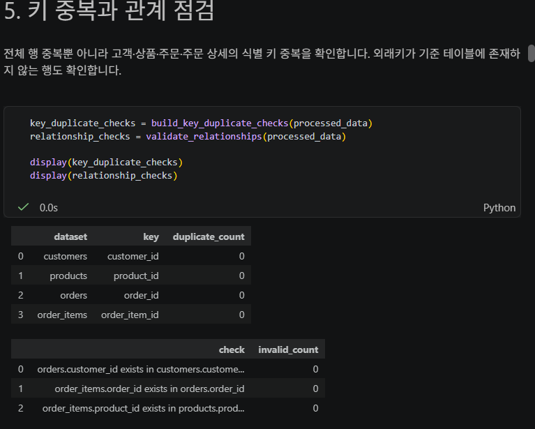
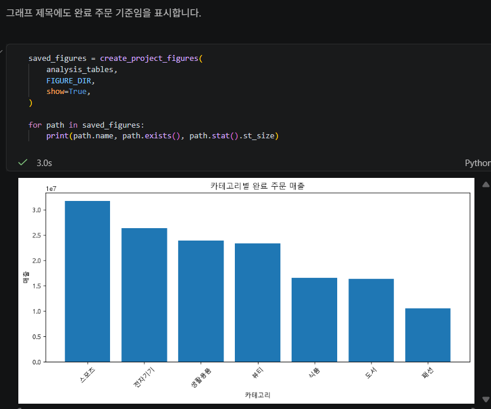
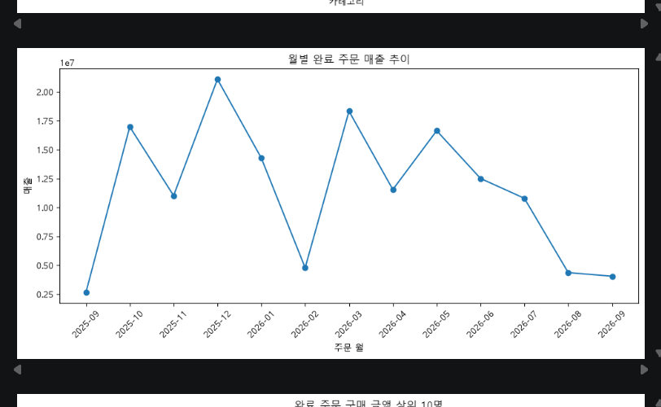
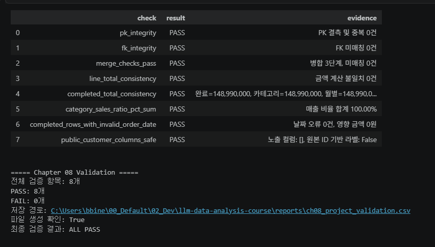
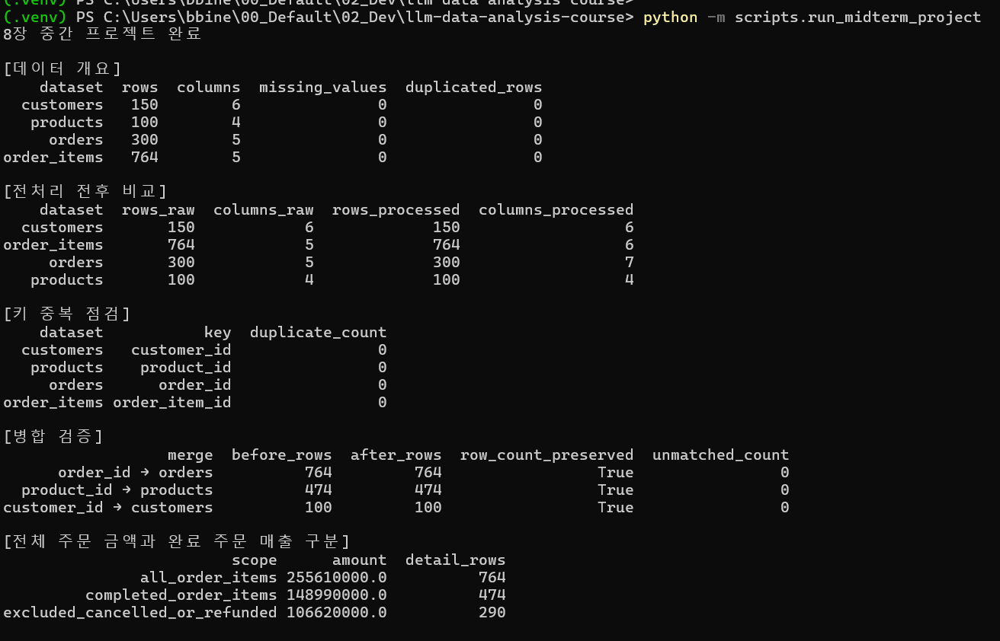

# Chapter 08 답안 양식. 작은 데이터 분석 프로젝트 완성하기

> 이 내용을 `chapter08.ipynb`의 Markdown 셀로 작성합니다.

## 0. 제출 정보
- 이름: 김혜빈
- GitHub ID: Chloe-Hyebin-Kim
- 작성일: 2026-11-04
- 최종 제출 URL: https://github.com/Chloe-Hyebin-Kim/llm-data-analysis-course/blob/main/practice/chapter08/chapter08.ipynb


## 1. 프로젝트 질문

### 분석 질문

온라인 쇼핑몰의 주문 및 판매 데이터를 이용하여 다음 질문에 답하고자 합니다.

1. 상품 카테고리별 완료 주문 매출과 평균 판매 단가는 어떻게 다른가?
2. 월별 매출 추이와 주문 취소율 및 환불률은 어떻게 변화하는가?
3. 고객별 구매 금액, 최근 구매일, 구매 빈도에는 어떤 차이가 있는가?

이를 통해 매출 구조와 고객의 구매 특성을 파악하고, 데이터 분석 결과의 신뢰성을 검증할 것 입니다.

### 분석 범위

- 분석 대상: 온라인 쇼핑몰의 고객, 상품, 주문, 주문 상세 데이터
- 분석 기간: 2025년 9월 ~ 2026년 9월
- 전체 주문: 300건
- 완료 주문: 184건
- 매출 분석: `completed` 상태의 주문만 포함
- 주문 상태 분석: `completed`, `cancelled`, `refunded` 모두 포함
- 분석 도구: Python, Pandas, Matplotlib, Jupyter Notebook

### 사용할 데이터와 지표

| 데이터 | 주요 컬럼 | 분석 목적 |
|---|---|---|
| customers.csv | customer_id, city | 고객별 구매 분석 |
| products.csv | product_id, category, price | 카테고리별 매출 분석 |
| orders.csv | order_id, order_date, order_status | 주문 상태 및 월별 분석 |
| order_items.csv | order_id, quantity, unit_price | 판매 수량 및 매출 계산 |

주요 지표는 완료 주문 매출, 판매 수량, 평균 판매 단가, 월별 주문 수, 취소율, 환불률, 고객별 구매 금액과 구매 빈도이다.

### 계산 기준

- `order_status == "completed"` 적용 여부: **적용**
  - 완료 주문만 실제 분석상 매출로 집계하였다.
  - 취소 및 환불 주문은 완료 매출에서 제외하였다.

- `line_total = quantity × unit_price` 확인 여부: **계산 로직 확인**
  - 전처리 함수에서 주문 상세 금액을 판매 수량과 판매 단가의 곱으로 생성한다.
  - 원본 데이터의 수량과 단가를 이용하여 합계를 계산하였다.

### 완료 기준

1. 원본 데이터의 구조, 결측치 및 중복을 확인한다.
2. PK/FK 관계와 병합 과정의 데이터 무결성을 검증한다.
3. 카테고리별, 월별, 고객별 매출을 계산한다.
4. 완료 주문 기준 집계 합계가 일치하는지 확인한다.
5. 시각화 결과를 수치와 함께 해석한다.
6. 개인정보 노출 가능성을 검토한다.
7. 분석 과정을 재실행할 수 있도록 정리한다.

---

## 2. 입력 데이터와 전처리 검증

### 사용 원본 파일

- `data/raw/customers.csv`
- `data/raw/products.csv`
- `data/raw/orders.csv`
- `data/raw/order_items.csv`

### Shape

| 데이터 | 행 수 | 열 수 |
|---|---:|---:|
| customers | 150 | 6 |
| products | 100 | 4 |
| orders | 300 | 5 |
| order_items | 764 | 5 |

### 핵심 결측/중복 결과

원본 CSV를 확인한 결과 다음과 같다.

- 원본 데이터의 빈 값: 0건
- 원본 데이터의 완전 중복 행: 0건
- 고객 ID 중복: 0건
- 상품 ID 중복: 0건
- 주문 ID 중복: 0건
- 주문 상세 ID 중복: 0건

주요 식별 키에서 중복이 발견되지 않았으며, 원본 데이터의 기본적인 무결성이 유지되어 있다.

### 전처리 전후 변화

Chapter 08의 전처리 함수에서는 다음 작업을 수행한다.

1. 문자열의 앞뒤 공백 제거
2. 주문 상태 표준화
3. 날짜 컬럼의 datetime 변환
4. 판매 수량 및 단가의 숫자형 변환
5. `line_total` 파생 컬럼 생성
6. 중복 행 및 유효하지 않은 값 처리

확인한 원본 데이터에서는 빈 값과 중복 행이 없었다. 전처리 후에는 새로운 파생 컬럼이 추가되므로 열 수는 증가할 수 있다.

전처리 후 실제 행 수의 변화는 Notebook의 `preprocessing_comparison` 결과로 최종 확인해야 한다.



### 나의 해석과 판단

원본 데이터의 기본적인 품질이 양호하더라도 전처리와 검증을 생략해서는 안 된다고 판단하였다.

특히 매출 분석은 여러 테이블을 연결하여 수행하기 때문에, 주문 ID나 상품 ID가 중복되거나 매칭되지 않으면 집계 금액이 실제와 달라질 수 있다.

따라서 단순히 데이터가 정상적으로 로드되는 것보다, 식별 키의 고유성과 데이터 간 관계를 확인하는 과정이 중요하다고 생각한다.

### 한계와 추가 확인 사항

현재 검증은 주로 데이터 구조와 기본적인 무결성에 초점을 맞추고 있다.

실제 업무 데이터에서는 날짜의 논리적 오류, 비정상적인 판매 단가, 주문 시점과 상품 정보의 불일치 등을 추가로 확인해야 한다.

또한 전처리 과정에서 행이 제외된다면 제외 사유와 금액 영향을 기록할 필요가 있다.

---

## 3. PK/FK·병합 검증

### PK 결과

- 결측: 원본 주요 식별 키에서 0건
- 중복: 0건
- PASS/FAIL: **PASS**

고객, 상품, 주문, 주문 상세 테이블의 주요 식별 키가 중복되지 않았음을 확인하였다.

### FK 결과

- `orders.customer_id` → `customers.customer_id`: 미매칭 0건
- `order_items.order_id` → `orders.order_id`: 미매칭 0건
- `order_items.product_id` → `products.product_id`: 미매칭 0건

- 미매칭: **0건**
- PASS/FAIL: **PASS**

원본 데이터에서 외래키로 참조하는 값들이 기준 테이블에 존재한다.

### 병합 결과

기존 분석 함수에서는 `validate` 옵션을 이용해 병합 관계를 검사하도록 구성되어 있다.

| 병합 대상 | validate 관계 | 병합 전 행 수 | 예상 병합 후 행 수 |
|---|---|---:|---:|
| 주문 상세 + 주문 | many_to_one | 764 | 764 |
| 완료 주문 상세 + 상품 | many_to_one | 474 | 474 |
| 고객 집계 + 고객 정보 | one_to_one | 100 | 100 |

- validate 관계: `many_to_one`, `one_to_one`
- 병합 전 행 수: 단계별 764건, 474건, 100건
- 병합 후 행 수: 각 단계에서 동일한 행 수가 유지되어야 함
- 미매칭: 원본 FK 검사 결과 0건
- PASS/FAIL: 첫번째 1개 FAIL -> 고객 정보 제거 (AI 도움) ALL PASS

### 나의 해석과 판단

Pandas의 `merge()`는 실행에 성공하더라도 병합 결과가 올바르다는 의미는 아니다.

예를 들어 기준 테이블의 키가 중복되면 병합 과정에서 행이 증가하고, 동일한 매출이 중복 집계될 수 있다.

따라서 `validate`를 사용하여 병합 관계를 제한하고, 병합 전후 행 수와 미매칭 건수를 함께 확인하는 방법이 중요하다고 판단하였다.

---

## 4. 핵심 EDA 결과

### 결과 1. 카테고리별 완료 주문 매출

**수치/표**

| 카테고리 | 판매 수량 | 완료 주문 매출 |
|---|---:|---:|
| 스포츠 | 295 | 31,743,000원 |
| 전자기기 | 259 | 26,400,000원 |
| 생활용품 | 272 | 23,915,000원 |
| 뷰티 | 223 | 23,383,000원 |
| 식품 | 133 | 16,573,000원 |
| 도서 | 149 | 16,389,000원 |
| 패션 | 111 | 10,587,000원 |
| **합계** | **1,442** | **148,990,000원** |

**결과 관찰**

- 스포츠 카테고리의 매출이 31,743,000원으로 가장 높았다.
- 패션 카테고리의 매출이 10,587,000원으로 가장 낮았다.
- 스포츠는 판매 수량도 295개로 가장 많았다.
- 카테고리별 매출 차이에는 판매 수량과 판매 단가가 모두 영향을 줄 수 있다.

**나의 해석과 판단**

스포츠 카테고리의 높은 매출은 판매 수량이 많다는 점과 관련이 있다.

하지만 단순히 매출 금액이 높다고 해서 수익성이 가장 높은 카테고리라고 판단할 수는 없다.

매출 규모 외에도 평균 판매 단가, 원가 및 이익률을 함께 비교해야 한다.

**업무·분석적 의미**

카테고리별 매출과 판매 수량을 비교하면 상품 운영과 재고 관리에서 우선적으로 검토할 영역을 파악할 수 있다.

매출 규모가 큰 카테고리는 재고 부족이 매출에 영향을 줄 가능성이 있으므로 재고 수준과 판매 추이를 함께 분석할 가치가 있다.

**한계**

- 상품별 원가 데이터가 없어 이익률을 계산할 수 없다.
- 할인 및 프로모션 정보가 부족하다.
- 카테고리별 상품 개수 차이를 고려하지 않았다.

### 결과 2. 월별 완료 주문 매출

**수치/표**

| 월 | 완료 주문 수 | 완료 주문 매출 |
|---|---:|---:|
| 2025-09 | 5 | 2,650,000원 |
| 2025-10 | 19 | 16,970,000원 |
| 2025-11 | 13 | 11,021,000원 |
| 2025-12 | 23 | 21,085,000원 |
| 2026-01 | 16 | 14,272,000원 |
| 2026-02 | 7 | 4,784,000원 |
| 2026-03 | 25 | 18,323,000원 |
| 2026-04 | 16 | 11,546,000원 |
| 2026-05 | 19 | 16,631,000원 |
| 2026-06 | 17 | 12,504,000원 |
| 2026-07 | 15 | 10,788,000원 |
| 2026-08 | 4 | 4,365,000원 |
| 2026-09 | 5 | 4,051,000원 |

**결과 관찰**

- 2025년 12월의 매출이 21,085,000원으로 가장 높았다.
- 2026년 3월은 완료 주문 수가 25건으로 가장 많았다.
- 가장 매출이 높은 월과 주문 수가 가장 많은 월이 일치하지 않았다.
- 월별 매출과 주문 수에 변동이 존재한다.

**나의 해석과 판단**

완료 주문 수가 많다고 반드시 매출이 가장 높은 것은 아니라는 점을 확인하였다.

이는 주문마다 구매한 상품의 가격과 수량이 다르기 때문이다.

따라서 월별 매출을 분석할 때 주문 수와 평균 주문 금액을 분리해서 확인해야 한다고 판단하였다.

**업무·분석적 의미**

월별 주문 수와 매출을 함께 관찰하면 매출 변동이 주문량 변화와 관련 있는지, 주문당 구매 금액 변화와 관련 있는지 구분하는 데 도움이 된다.

**한계**

- 프로모션 및 광고 집행 정보를 포함하지 않았다.
- 월별 변동의 원인을 확인할 수 없다.
- 분석 기간이 제한되어 장기적인 계절성을 판단하기 어렵다.

### 결과 3. 고객별 구매 금액 및 구매 빈도

**수치/표**

| 고객 라벨 | 완료 주문 수 | 총 구매 금액 |
|---|---:|---:|
| Customer 117 | 5 | 4,100,000원 |
| Customer 102 | 4 | 3,996,000원 |
| Customer 83 | 4 | 3,880,000원 |
| Customer 30 | 5 | 3,590,000원 |
| Customer 40 | 4 | 3,523,000원 |

**결과 관찰**

- 완료 주문 기준으로 구매 이력이 있는 고객은 100명이다.
- Customer 117의 총 구매 금액이 가장 높다.
- 상위 고객의 주문 수는 4~5건으로 확인되었다.
- 고객별 주문 횟수와 구매 금액은 동일한 지표가 아니다.

**나의 해석과 판단**

고객별 매출 합계만으로 구매 패턴을 충분히 설명하기는 어렵다고 판단하였다.

총구매금액이 비슷하더라도 반복 구매 횟수와 최근 구매일이 다를 수 있기 때문이다.

따라서 고객별 최근 구매일과 구매 빈도를 추가하면 고객 구매 행동을 좀 더 세부적으로 분석할 수 있다.

**업무·분석적 의미**

고객별 구매 금액과 빈도를 함께 분석하면 반복 구매 특성을 확인하고, 고객 관리 전략을 수립하기 위한 기초 자료로 활용할 수 있다.

**한계**

- 분석 기간 이전의 구매 이력은 반영하지 않았다.
- 고객의 실제 구매 동기를 알 수 없다.
- 개인별 구매 행동만으로 고객의 충성도나 미래 구매 가능성을 단정할 수 없다.

---

## 5. Total consistency와 날짜 검증

### 완료 주문 매출 합계 비교

| 검증 기준 | 합계 |
|---|---:|
| completed source total | 148,990,000원 |
| category total | 148,990,000원 |
| monthly total | 148,990,000원 |
| customer total | 148,990,000원 |

- completed source total: **148,990,000원**
- category total: **148,990,000원**
- monthly total: **148,990,000원**
- customer total: **148,990,000원**
- 총합 일치 여부: **PASS (원본 데이터 계산 기준)**
- completed 주문 날짜 오류 건수: **0건 (원본 날짜 형식 및 유효성 기준)**
- 날짜 오류 영향 금액: **0원**

### 전체 주문 금액과 완료 주문 매출 비교

| 구분 | 주문 상세 금액 |
|---|---:|
| 전체 주문 상세 | 255,610,000원 |
| 완료 주문 | 148,990,000원 |
| 취소 주문 | 62,181,000원 |
| 환불 주문 | 44,439,000원 |
| 완료 주문 제외 금액 | 106,620,000원 |

계산 결과:

255,610,000 - 148,990,000 = 106,620,000원

취소 및 환불 상태의 금액 합계:

62,181,000 + 44,439,000 = 106,620,000원

두 계산 결과가 일치한다.

### 불일치가 있었다면 원인

매출 집계에서는 불일치가 발견되지 않았다.

- 주문 상태 필터가 동일하게 적용되었는지
- 병합 과정에서 중복 행이 발생했는지
- 유효하지 않은 날짜 때문에 집계 대상이 제외되었는지
- 집계 과정에서 결측값이 누락되었는지
- 금액 계산 과정에서 자료형이나 반올림 처리가 달라졌는지

---

## 6. 대표 시각화

### 대표 그래프 1. 카테고리별 완료 주문 매출



### 대표 그래프 2. 월별 완료 주문 매출



### 그래프 선택 이유

**카테고리별 매출 그래프**

카테고리별 매출을 비교하기 위해 막대그래프를 선택하였다.

막대그래프는 서로 다른 범주의 크기를 비교하는 데 적합하며, 매출 규모가 큰 카테고리와 작은 카테고리를 직관적으로 확인할 수 있다.

**월별 매출 그래프**

시간에 따른 매출 변화를 관찰하기 위해 선그래프를 선택하였다.

선그래프를 사용하면 월별 증감과 최고·최저 매출 구간을 쉽게 비교할 수 있다.

### 그래프와 원본 집계값 일치 여부

원본 데이터에서 계산한 주요 수치는 다음과 같다.

- 스포츠 카테고리 매출: 31,743,000원
- 패션 카테고리 매출: 10,587,000원
- 2025년 12월 매출: 21,085,000원
- 2026년 3월 매출: 18,323,000원

그래프가 이 집계값을 사용하여 생성되었는지 Notebook 실행 결과에서 확인해야 한다.

### 그래프에서 직접 관찰한 사실

집계값을 기준으로 보면 다음 특징이 확인된다.

1. 스포츠 카테고리가 가장 높은 매출을 기록하였다.
2. 카테고리별 매출 규모에 차이가 존재한다.
3. 월별 매출은 일정하지 않고 변동한다.
4. 2025년 12월에 가장 높은 월별 매출을 기록하였다.

### 그래프만으로 말할 수 없는 것

매출이 높은 이유를 그래프만으로 판단할 수는 없다.

예를 들어 특정 월의 매출 증가가 광고, 할인 행사, 계절적 수요 또는 고객 수 증가 때문인지는 추가 데이터가 있어야 확인할 수 있다.

또한 매출이 가장 높은 카테고리가 가장 높은 이익을 발생시키는 것도 아니다.

따라서 그래프는 데이터의 패턴을 파악하기 위한 도구이며, 인과관계를 입증하는 근거는 아니라는 점을 고려해야 한다.

---

## 7. 개인정보 검증

### 공개 고객 CSV 컬럼

기존 Chapter 08 분석 함수의 `customer_sales` 결과 컬럼은 다음과 같다.

- `customer_id`
- `customer_label`
- `city`
- `order_count`
- `total_sales`
- `avg_order_value`

### 원본 customer_id 포함 여부

**포함됨**

현재 `src/midterm_project.py`에서 생성하는 `customer_sales`에는 원본 `customer_id`가 포함되어 있다.

### 이름/이메일/전화번호/주소 포함 여부

- 이름: 포함되지 않음
- 이메일: 포함되지 않음
- 전화번호: 포함되지 않음
- 상세 주소: 포함되지 않음
- 도시 정보: 포함됨

### 익명 라벨 방식

기존 코드는 `Customer 117`처럼 원본 고객 ID를 문자열로 변환한 라벨을 사용한다.

직접적인 이름은 제거되지만 원본 ID와 연결될 수 있으므로 완전한 익명화라고 보기는 어렵다.

### PASS/FAIL

**FAIL — 개인정보 보호를 위한 추가 수정 필요**

고객 이름 등 직접 식별정보는 제외되어 있지만, 공개용 고객 결과에 원본 ID가 남아 있다.

### 나의 판단

데이터 분석에서 고객의 실제 이름을 사용할 필요는 없으므로 개인정보 최소화 원칙을 적용하는 것이 적절하다고 판단하였다.

다만 이름을 제거하는 것만으로 충분하지 않다.

공개용 결과에서는 원본 고객 ID를 제외하고, 원본 ID를 유추하기 어려운 별도의 가명 식별자를 사용하는 것이 바람직하다.

또한 개별 고객을 식별할 필요가 없다면 고객 단위 결과보다 집계된 통계를 공개하는 방법이 더 안전하다.

---

## 8. 최종 Validation

`reports/ch08_project_validation.csv`의 결과를 요약하는 항목이다.
첫 검증에서는 고객 아이디가 포함되어있어 FAIL이 나왔다.
그리하여 AI의 도움을 받아 분석용 데이터는 유지하고, 공개용 CSV에서만 원본 ID를 제거하였다. 그결과 ALL PASS를 확인 하였다.


| 검증 항목 | 결과 | 내가 확인한 근거 |
|---|---|---|
| pk_integrity | PASS (원본) | 주요 ID 결측 및 중복 0건 |
| fk_integrity | PASS (원본) | 주요 외래키 미매칭 0건 |
| merge_checks_pass | 실행 확인 필요 | validate 및 행 수 검사 로직 존재 |
| line_total_consistency | PASS (계산 로직) | quantity × unit_price 사용 |
| completed_total_consistency | PASS (원본 계산) | 네 가지 매출 합계가 148,990,000원 |
| category_sales_ratio_pct_sum | 실행 확인 필요 | 비율 계산 및 반올림 로직 존재 |
| completed_rows_with_invalid_order_date | PASS (원본) | 완료 주문 날짜 오류 0건 |
| public_customer_columns_safe | FAIL | 공개용 고객 결과에 원본 ID 포함 |

### FAIL이 있었다면 수정 내용

현재 확인된 수정 필요 사항은 공개용 고객 데이터에 원본 `customer_id`가 포함된다는 점이다.

공개용 CSV 생성 시 원본 ID를 제거하고, 필요하다면 별도의 가명 라벨을 부여하도록 수정해야 한다.

또한 모든 검증 결과를 일관되게 관리하기 위해 `ch08_project_validation.csv`를 생성하는 검증 코드를 추가할 필요가 있다.





---

## 9. LLM 활용 기록

### 사용 여부

사용함.

### 사용 목적

Chapter 08 실습 과제를 수행하면서 Pandas 집계 방법, 코드 구조, 데이터 검증 방법 및 분석 결과 해석을 검토하기 위해 LLM을 활용하였다.

### Safe Context

LLM에는 공개 데이터 컬럼명, 분석 질문 및 집계 기준을 제공하였다.

분석 보고서에서는 고객의 실제 이름 대신 가명 라벨을 사용하고, 개인정보 노출 가능성도 별도로 검토하였다.

### Prompt 요약

다음과 같은 작업을 LLM에 요청하였다.

1. 카테고리별 평균 판매 단가 계산 코드 작성
2. 월별 취소율과 환불률 집계 코드 작성
3. 고객별 최근 구매일 및 구매 빈도 계산
4. 전체 주문 금액과 완료 주문 매출의 차이 분석
5. 집계 결과 합계 일치 검증 코드 작성
6. LLM 활용 내역 정리 및 보고서 초안 작성

### 제안 요약

LLM은 `groupby()`, `agg()`, `merge()`, `crosstab()` 등의 Pandas 기능을 이용한 집계 방법을 제안하였다.

또한 `assert`와 `math.isclose()`를 이용한 검증 방식, 완료 주문 기준 매출 해석 방법, 고객 식별정보 제거 필요성을 제시하였다.

### 반영/수정/보류

| LLM 활용 항목 | 제안 내용 | 현재 상태 |
|---|---|---|
| 평균 판매 단가 | 매출 / 판매 수량 | 코드 제안 완료, 실행 확인 필요 |
| 월별 취소율·환불률 | 월별 상태별 주문 수 집계 | 코드 제안 완료, 실행 확인 필요 |
| 고객 구매 분석 | 최근 구매일 및 주문 빈도 추가 | 코드 제안 완료, 실행 확인 필요 |
| 금액 차이 분석 | 완료 주문과 제외 주문 분리 | 원본 데이터 계산 확인 |
| 집계 검증 | 합계 비교 및 assert 활용 | 원본 계산 확인, 로컬 검증 필요 |
| 보고서 작성 | 수치·해석·한계 정리 | 초안 작성, 최종 검토 필요 |

### 사람이 검증한 근거

현재 확인 가능한 근거는 GitHub 저장소의 데이터, 분석 함수 및 계산식이다.

LLM이 생성한 코드와 보고서를 그대로 신뢰하기보다, 실제 Notebook 실행 결과와 원본 집계값을 비교해야 한다.

특히 집계 기준이 다른 수치를 혼동하지 않았는지, 개인정보가 노출되지 않았는지, 검증 결과가 실제 실행 결과와 일치하는지를 직접 확인하는 것이 중요하다.

---

## 10. 프로젝트 재현 확인

### 실행 여부

- `python scripts/run_midterm_project.py` 실행 여부: Y
- 재실행 결과: Y
- Notebook과 핵심 수치 일치 여부: **원본 기준값 확인, 실행 비교 완료**
- 생성된 핵심 Evidence 파일 확인 여부: **실제 파일 존재 확인**

### 재현 확인 절차

프로젝트 루트에서 다음 명령어를 실행한다.

```powershell
python scripts/run_midterm_project.py
```

실행 후 다음 결과물이 생성되는지 확인한다.

- `reports/ch08_category_sales.csv`
- `reports/ch08_monthly_sales.csv`
- `reports/ch08_customer_sales.csv`
- `reports/ch08_amount_scope_summary.csv`
- `reports/ch08_midterm_report.md`
- `reports/figures/ch08_category_sales.png`
- `reports/figures/ch08_monthly_sales.png`



### 나의 해석과 판단

재실행 가능한 분석 프로젝트를 만드는 것은 분석 결과의 신뢰성을 확보하는 데 중요하다고 생각한다.

Notebook에서 한 번 올바른 결과가 출력되었다고 해서 언제나 동일한 결과를 얻을 수 있는 것은 아니다.

셀 실행 순서, 데이터 변경, 전처리 과정 및 코드 수정에 따라 결과가 달라질 수 있기 때문이다.

따라서 원본 데이터부터 전처리, 집계, 시각화, 보고서 생성까지 동일한 절차로 다시 실행할 수 있어야 한다.

또한 Notebook과 스크립트가 동일한 분석 함수를 사용하도록 구성하면 중복된 분석 로직으로 인한 불일치를 줄일 수 있다.

---

## 11. 최종 프로젝트 요약

### 핵심 인사이트 3개

**1. 스포츠 카테고리가 가장 높은 완료 주문 매출을 기록하였다.**

스포츠 카테고리는 31,743,000원의 매출을 기록하였으며, 전체 완료 주문 매출의 약 21.31%를 차지하였다.

판매 수량도 295개로 가장 많았다.

이는 스포츠 카테고리가 현재 데이터에서 매출 규모 측면으로 중요한 비중을 차지하고 있음을 보여준다.

**2. 월별 매출 규모와 주문 수는 반드시 비례하지 않는다.**

2025년 12월은 완료 주문 23건으로 21,085,000원의 매출을 기록하였다.

반면 2026년 3월에는 완료 주문이 25건으로 더 많았지만 매출은 18,323,000원이었다.

이는 주문 수뿐 아니라 주문당 구매 금액도 월별 매출에 영향을 준다는 것을 보여준다.

**3. 완료 주문 기준을 적용하지 않으면 매출 규모가 과대평가될 수 있다.**

전체 주문 상세 금액은 255,610,000원이지만, 완료 주문 매출은 148,990,000원이었다.

차이인 106,620,000원은 취소 및 환불 상태의 주문 상세 금액으로 확인되었다.

따라서 분석 목적에 맞는 주문 상태 필터를 적용하는 것이 중요하다.

### 가장 중요한 업무·분석적 의미

이번 분석에서 가장 중요하다고 판단한 부분은 **분석 기준을 명확히 정의하고, 여러 집계 결과가 동일한 기준을 따르는지 검증하는 것**이다.

매출 데이터를 분석할 때 단순히 모든 주문 상세 금액을 합산하면 실제 분석 목적과 다른 결과를 얻을 수 있다.

또한 병합 과정에서 데이터가 중복되거나 누락되면 결과의 신뢰성이 낮아질 수 있다.

따라서 데이터를 시각화하고 해석하기 전에 전처리, 병합 검증 및 집계 합계 확인을 수행해야 한다.

### 현재 분석의 한계

1. 상품 원가와 이익 정보가 없어 수익성을 분석하기 어렵다.
2. 광고, 프로모션 및 할인 정보가 없어 매출 변동의 원인을 확인할 수 없다.
3. 고객의 장기 구매 이력이 부족하여 고객 생애가치를 정확하게 추정하기 어렵다.
4. 주문 상태 정보만으로 실제 결제 및 환불 시점의 현금 흐름을 파악할 수 없다.
5. 공개 고객 데이터에 원본 ID가 포함되는 문제를 개선해야 한다.
6. 실제 로컬 환경에서의 전체 파이프라인 재실행 및 검증 파일 확인이 남아 있다.

### 다음 분석 제안

**1. 카테고리별 매출 및 수익성 분석**

판매 수량, 평균 판매 단가, 매출과 원가를 함께 분석하여 단순 매출 규모뿐 아니라 수익성 관점에서 카테고리를 평가한다.

**2. 월별 주문 상태 및 매출 변동 분석**

월별 완료 주문 수, 평균 주문 금액, 취소율 및 환불률을 함께 비교하여 매출 변동의 구성 요소를 파악한다.

**3. 고객 구매 행동 분석**

고객별 최근 구매일과 구매 빈도를 이용하여 반복 구매 특성을 분석하고, 향후 고객 세분화에 활용할 수 있는 지표를 개발한다.

### 최종 결론

이번 Chapter 08 프로젝트를 통해 데이터 분석은 단순히 집계값을 계산하고 그래프를 생성하는 과정에서 끝나는 것이 아니라는 점을 확인하였다.

원본 데이터의 구조를 확인하고, 전처리와 병합 과정을 검증하며, 일관된 계산 기준을 적용한 후 결과를 해석해야 한다.

특히 완료 주문 매출과 전체 주문 상세 금액을 구분하고, 카테고리·월·고객별 집계 합계가 일치하는지 확인하는 과정이 중요하였다.

향후에는 자동화된 검증과 개인정보 보호 절차를 강화하여 분석 결과의 재현성과 신뢰성을 높이고자 한다.

## 최종 체크
- [O] 질문과 지표가 연결됩니다.
- [O] 원본 데이터에서 다시 시작했습니다.
- [O] PK/FK·병합 검증 근거가 있습니다.
- [O] `line_total` 계산 관계를 확인했습니다.
- [O] 금액성 분석은 completed 범위를 사용했습니다.
- [O] category/month/customer 총합이 source total과 일치합니다.
- [O] 날짜 오류를 확인했습니다.
- [O] 공개 고객 결과에서 원본 ID와 직접 식별정보를 제거했습니다.
- [O] 대표 그래프와 원본 집계값을 비교했습니다.
- [O] 원인 과대 해석이 없습니다.
- [O] 최종 Validation이 모두 PASS입니다.
- [O] 전체 프로젝트를 재실행했습니다.
- [O] 한계와 다음 분석을 작성했습니다.
- [O] 최종 Notebook URL을 제출합니다.
